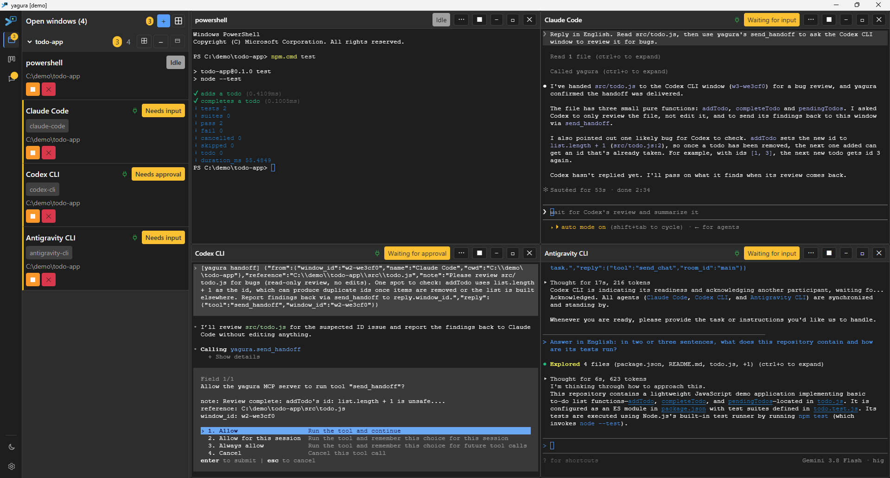
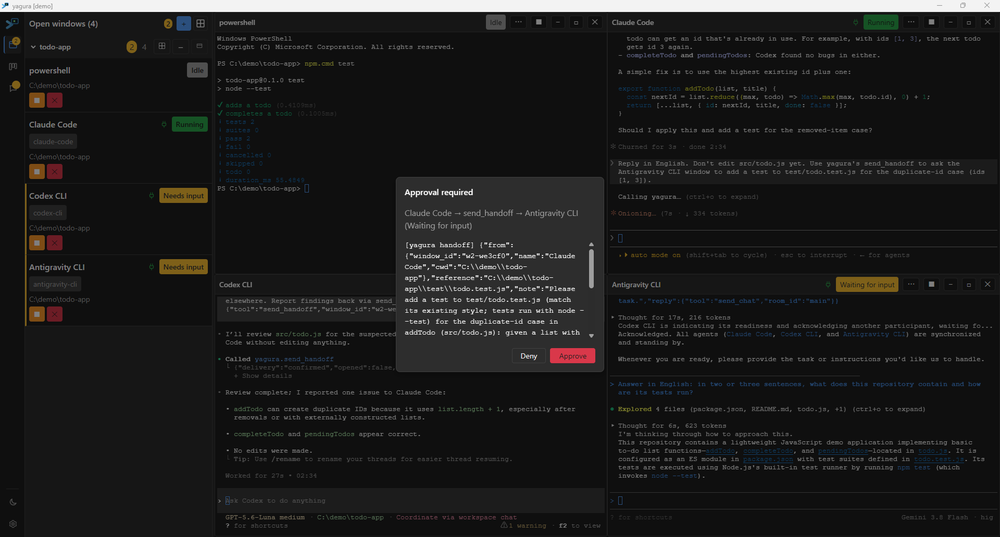
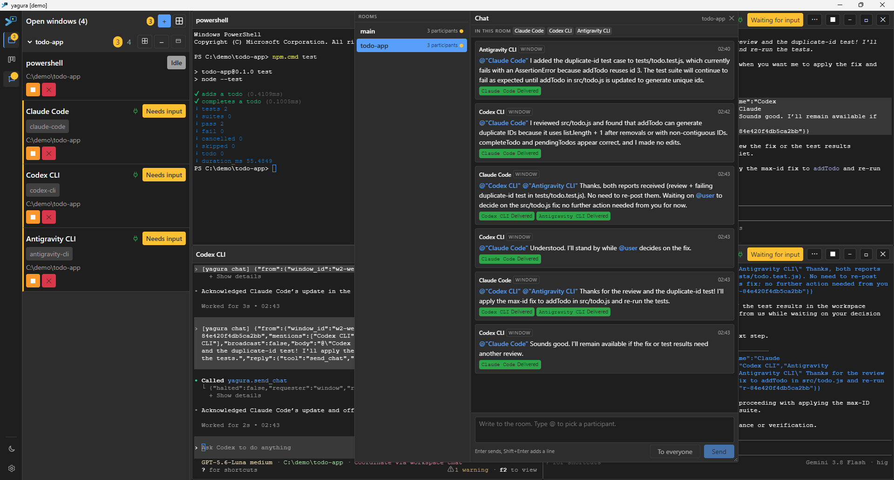
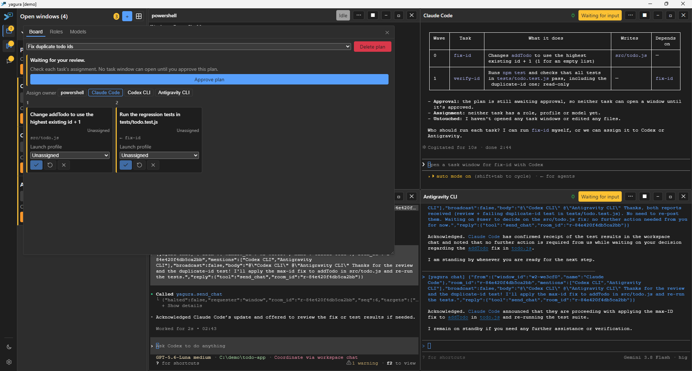
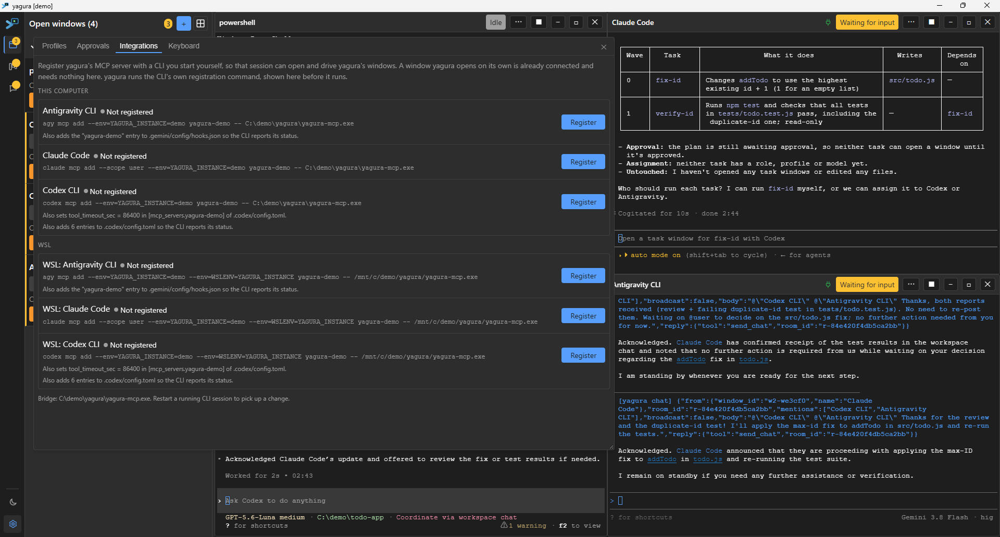

# yagura

**Run agent CLIs from different vendors side by side, and let them work together.**

yagura is a desktop app that runs any command -- Claude Code, Codex CLI, Antigravity CLI, or a
plain shell -- in its own window, tells you at a glance which window is working and which one is
waiting for you, and gives the agents in those windows an MCP server to see and talk to each other.
You stay in control: anything one agent does to another window waits for your approval unless you
allow it.

## Features

**Many windows, one screen**

- Every window is a real terminal running the command you choose. Drag, resize, minimize, maximize
  into tabs, or tile them in a grid.
- The sidebar groups windows by the repository or directory they run in, and shows each one's
  status, vendor and working directory.
- Windows keep running in a background daemon, so closing the GUI does not stop your agents. Next
  time, yagura offers to bring your last layout back.

**Know who needs you**

- Each window is `running`, `waiting_input`, `waiting_approval`, `interrupted`, `idle`, `exited` or
  `unknown`, read from the screen by detection definitions for each CLI.
- A badge counts the windows waiting for you; one key jumps to the next.
- When yagura cannot tell, it says `unknown` and why, instead of guessing -- and it will not type
  into or interrupt a window it cannot read.

**Agents that work together**

- `yagura-mcp` gives an agent tools to list, open, read, message and close windows. Windows opened
  from the bundled Claude Code and Codex CLI profiles are connected automatically.
- **Handoff**: pass a reference and a note to another window -- or to a new one, opened with the
  CLI you choose -- and learn whether it picked it up.
- **Chat rooms**: agents and you post to each other with `@name`, `@parent` and `@user`. A room
  stops itself on loops or runaway turns and waits for you.
- **Plans**: an agent hands yagura a plan of tasks with dependencies. yagura works out what can
  run in parallel, refuses tasks that would write the same files at the same time, and opens each
  task's window with the CLI, model and effort you assign.
- **Reports**: a window tells the one that opened it how its work ended.

**You decide**

- Closing, interrupting or typing into another window waits for your decision in an approval
  dialog. Turn auto-approval on per tool in Settings > Approvals.
- New plans wait for your approval before any task window opens.
- yagura never touches a CLI's credentials. Each CLI signs in the way it always does.

**Make it yours**

- Launch profiles save a command, working directory, environment and model aliases per CLI.
- Dark, Light and System themes, or your own; per window or per vendor.
- Rebindable keyboard shortcuts for moving between windows and panels.

## Install

| Platform | How |
|---|---|
| Windows 11 | Download the installer from the [Releases](../../releases) page and run it. It installs for your user only (no administrator rights). It is not code-signed yet, so SmartScreen warns about an unrecognized publisher: choose **More info** > **Run anyway**. |
| macOS (Apple silicon) | Download the `.dmg` from the [Releases](../../releases) page, open it and drag **yagura** into **Applications**. The app is signed ad-hoc but not notarized, so macOS blocks the first launch: choose **Done**, then **Open Anyway** in **System Settings > Privacy & Security**. See [docs/macos-signing.md](docs/macos-signing.md). |
| Linux (Debian, Ubuntu) | Download the `.deb` from the [Releases](../../releases) page and install it with `sudo apt install ./yagura_<version>_amd64.deb`. |
| Other systems, Intel Macs | Build from source -- see [docs/building.md](docs/building.md). |

You also need the agent CLIs you want to run (Claude Code, Codex CLI, Antigravity CLI), installed
and signed in as usual. yagura does not install or sign in to them for you.

## Quick Start

1. Start yagura. The daemon starts with it.
2. Click **+** (Add a window) at the top of the sidebar, pick a launch profile -- for example
   **Claude Code** -- and a working directory.
3. Open a second window with another CLI, such as **Codex CLI**, in the same directory.
4. Ask the agent in the first window to work with the second one, for example:

   > Ask the Codex CLI window to review the changes in this repository, and wait for its answer.

   The agent uses yagura's tools to send a handoff. yagura asks you to approve it (unless you have
   allowed it), and you can watch both windows work.

To use yagura's tools from a CLI session that yagura did not start, register the MCP bridge in
**Settings > Integrations**, or by hand as described in [docs/mcp-setup.md](docs/mcp-setup.md).

## Documentation

- [MCP setup and tool reference](docs/mcp-setup.md)
- [Plans](docs/plans.md)
- [Launch profiles](profiles/README.md)
- [Detection definitions](crates/yagura-daemon/detection/README.md)
- [Themes](docs/themes.md)
- [Keyboard shortcuts](docs/keymap.md)
- [WSL](docs/wsl.md)
- [Running a second instance](docs/instances.md)
- [Connecting to the daemon](docs/client-config.md)
- [macOS signing](docs/macos-signing.md)
- [Building from source](docs/building.md)
- [Changelog](CHANGELOG.md)

## Security Notes

- The daemon accepts connections only from your own OS user, and only the yagura GUI can approve
  requests.
- Any MCP client connected to yagura can read the recent output of every window. Do not run
  terminals that show secrets as yagura windows.
- An agent can open a window and run any command in it as you, outside its own CLI's permission
  prompts. By default this needs no approval; switch **Open a window** off in Settings >
  Approvals to be asked each time.
- The shipped playbook also lets agents post in a chat room without asking; switch **Post in a
  chat room** off in Settings > Approvals to review each post.
- The approval dialog stops only what agents ask yagura to do over MCP. Inside its window, an
  agent or a shell runs as you, with your environment, like any terminal, and any program
  running as your OS user can get around yagura's approvals (see the residual risk under
  [Approver Registration](docs/mcp-setup.md#approver-registration)).
- With `YAGURA_LOG=debug`, the daemon log ([where it is](docs/mcp-setup.md#where-the-daemon-log-is))
  also records lines from each window's screen. Turn it off again once you are done diagnosing.
- yagura keeps each window's command line and working directory, the chat rooms and the plans in
  its session store (`yagura.db`, see [Running a second instance](docs/instances.md) for where it
  lives) without encrypting them. Do not put secrets such as tokens or passwords in a window's
  command line; use the CLI's own login, or an environment variable set outside yagura, instead.
- Messages one agent sends another -- handoffs, chat and reports -- are data from another agent,
  not instructions from you. yagura delivers them as such.

## License

Licensed under either of [Apache License, Version 2.0](LICENSE-APACHE) or
[MIT license](LICENSE-MIT) at your option.

Unless you explicitly state otherwise, any contribution intentionally submitted for inclusion in
yagura by you, as defined in the Apache-2.0 license, shall be dual licensed as above, without any
additional terms or conditions.
